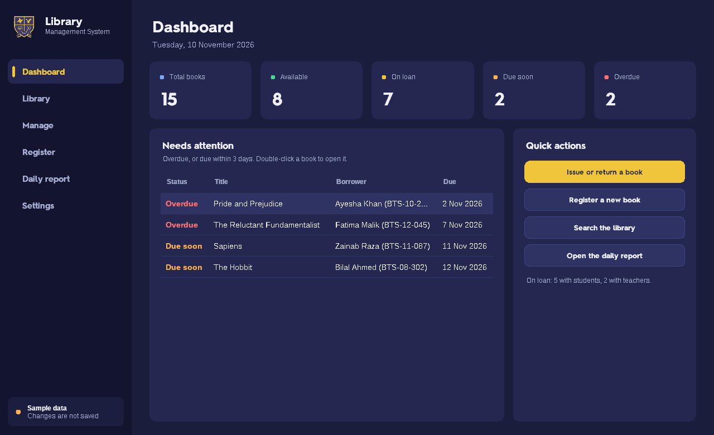
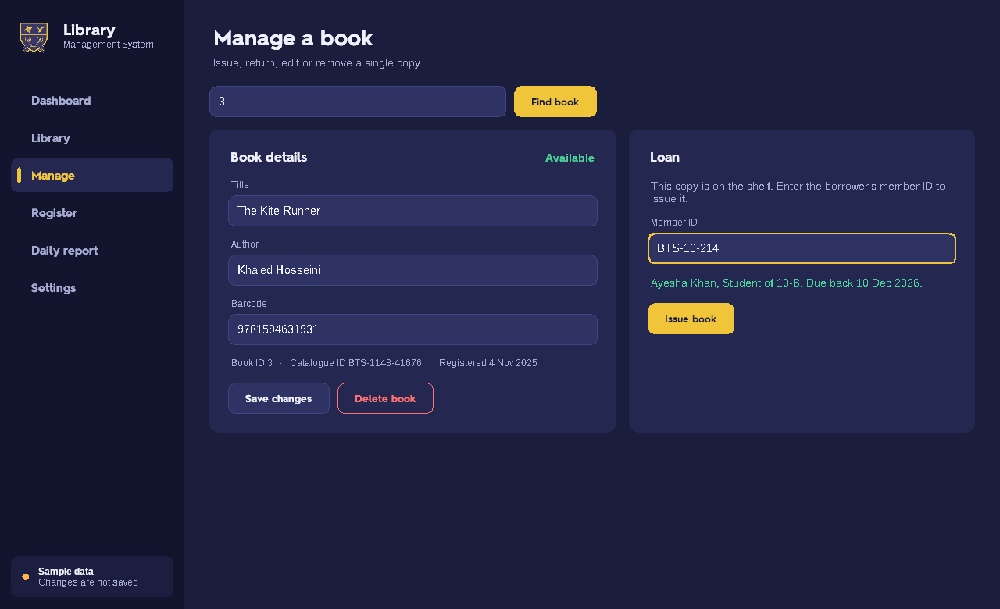
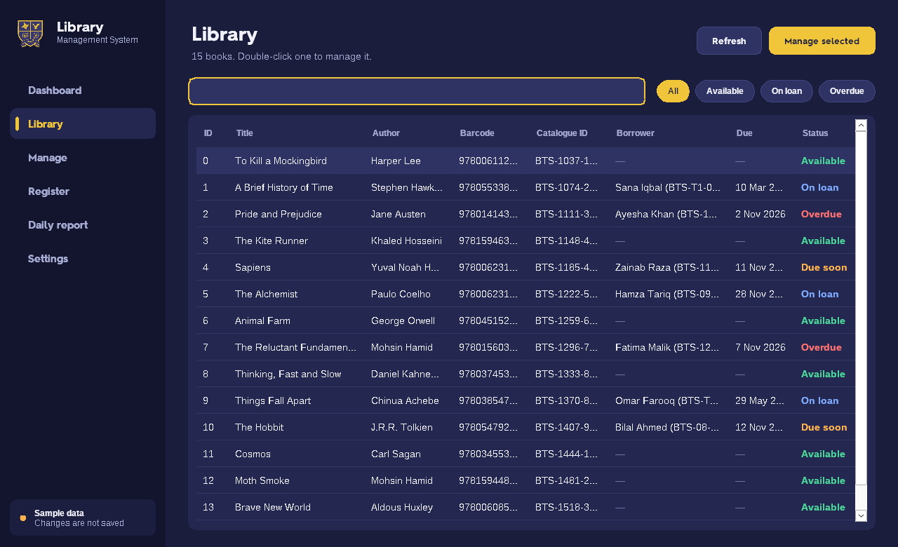
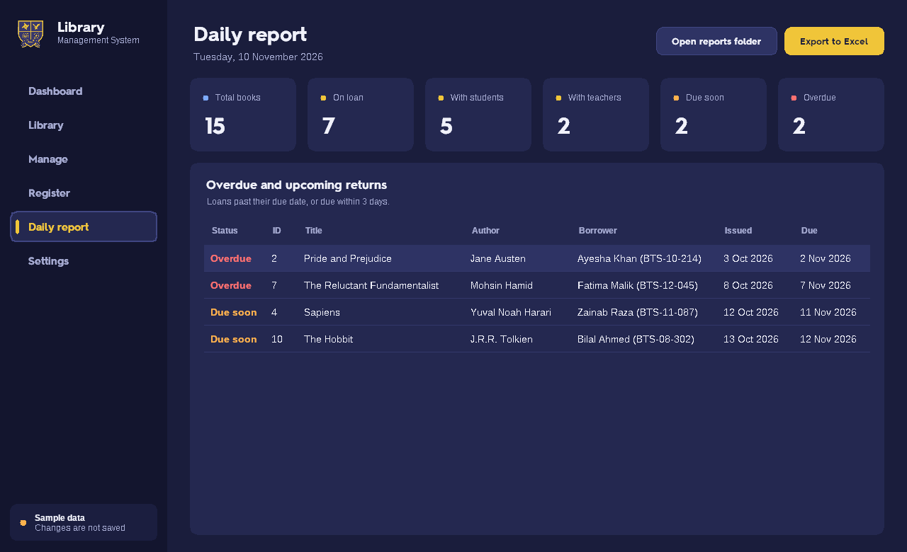

# Library Management System

A Windows desktop app for running a school library: a catalogue of books, issuing and
returning them to students and teachers, a daily report of what is overdue, and an Excel
export. Data lives in Google Cloud Firestore, so every library computer sees the same
books.

Built with C# and WinForms on .NET 8.

| Dashboard | Issue / return |
| --- | --- |
|  |  |
| **Library** | **Daily report** |
|  |  |

## Features

- **Dashboard** with totals and the loans that need chasing (overdue, or due within 3 days).
- **Library** with search-as-you-type across title, author, barcode, IDs and borrower.
- **Manage a book**: look it up by ID, catalogue label or barcode, then issue, return,
  edit or delete it. Works with USB barcode scanners (they type the code and press Enter).
- **Lending rules** in one place: students borrow for a month, teachers until the end of
  the school year (25 June).
- **Daily report** on screen and as an Excel workbook, optionally saved automatically once a day.
- **Sample-data mode** to try the app without a Firebase project.

## Run it

You need Windows 10 or 11 and the [.NET 8 SDK](https://dotnet.microsoft.com/download/dotnet/8.0).

Try it with the built-in sample library (nothing is saved):

```bash
dotnet run --project src/LibraryManagement.App -- --demo
```

Run it normally:

```bash
dotnet run --project src/LibraryManagement.App
```

Or open `LibraryManagementSystem.sln` in Visual Studio 2022 and press F5.

## Connect it to Firebase

The app needs a **service-account key** for your Firebase project. Nothing about the
project is compiled into the app.

1. In the [Firebase console](https://console.firebase.google.com/) open
   **Project settings → Service accounts** and click **Generate new private key**.
2. Start the app and click **Choose key file…** (or use **Settings → Data source** later).

The app remembers the file's location for your Windows user. Two alternatives need no
clicking:

- save the key next to the `.exe` as `firebase-credentials.json`, or
- set the `GOOGLE_APPLICATION_CREDENTIALS` environment variable to the key's path.

> **Keep the key secret.** It gives full access to the project's data. Never commit it:
> `.gitignore` already blocks the usual file names. If a key is ever shared or pushed by
> accident, delete it in the Firebase console and generate a new one.

### Firestore layout

The app reads and writes two collections. Field names are the ones the first version of
the app created, so existing data keeps working.

| Collection | Document ID | Fields |
| --- | --- | --- |
| `Books` | running number (`0`, `1`, …) | `Name`, `Author`, `Barcode`, `BTSID`, `Available` (bool), `RegistrationDate`, `IssueDate`, `DueDate`, `IssuedBy`, `IssuedBy_BTSCID`, `IssuedBy_Level`, `IssuedBy_Section` |
| `Users` | any | `BTSCID` (e.g. `BTS-10-214`), `Name`, `Level` (`Student` or `Teacher`), `Section` |

Dates are stored as `dd-MM-yyyy` text and empty values as the text `null`. Members are
added in the Firebase console; the app does not edit them.

## Project layout

```
src/
  LibraryManagement.Core/     No UI. Runs anywhere .NET runs, so it can be unit-tested.
    Models/                   Book, Loan, Member, lending rules, statistics, search
    Data/                     ILibraryRepository + Firestore and in-memory implementations
    Services/LibraryStore.cs  The app's state and every operation a librarian can perform
    Reporting/                Excel export of the daily report
    Configuration/            Per-user settings (JSON under %AppData%)
  LibraryManagement.App/      The WinForms app
    Ui/                       Theme, bundled font, custom-drawn controls
    Views/                    One class per screen
    MainForm.cs               Sidebar, navigation, busy indicator, notifications
tests/
  LibraryManagement.Core.Tests/   xUnit tests for the Core project
```

The screens are built in code (see `Ui/Make.cs`) rather than with the drag-and-drop
designer, which keeps each one short and lets the layout stretch and scale with the
display's DPI.

### Where things are stored

| What | Where |
| --- | --- |
| Settings | `%AppData%\Library Management System\settings.json` |
| Error log | `%AppData%\Library Management System\logs\app.log` |
| Reports | `Documents\Library Management System` (changeable in Settings) |

The display font (Starz 2016), the crest and the icon are embedded in the executable, so
the app looks the same on any computer without installing anything.

## Tests

```bash
dotnet test
```

The tests cover the lending rules, due-date and overdue logic, reading and writing the
Firestore document format, every `LibraryStore` operation (against the in-memory
repository), settings, and the Excel export.

## Make a copy for another computer

```bash
dotnet publish src/LibraryManagement.App -c Release -r win-x64 --self-contained true -o publish
```

Copy the whole `publish` folder to the other PC and run `LibraryManagementSystem.exe`.
.NET does not need to be installed there.

## Licences

- This project: see [LICENSE](LICENSE).
- [EPPlus](https://epplussoftware.com/) is used under its Polyform Noncommercial licence,
  which covers non-commercial use such as a school library. Commercial use needs a paid
  EPPlus licence.
